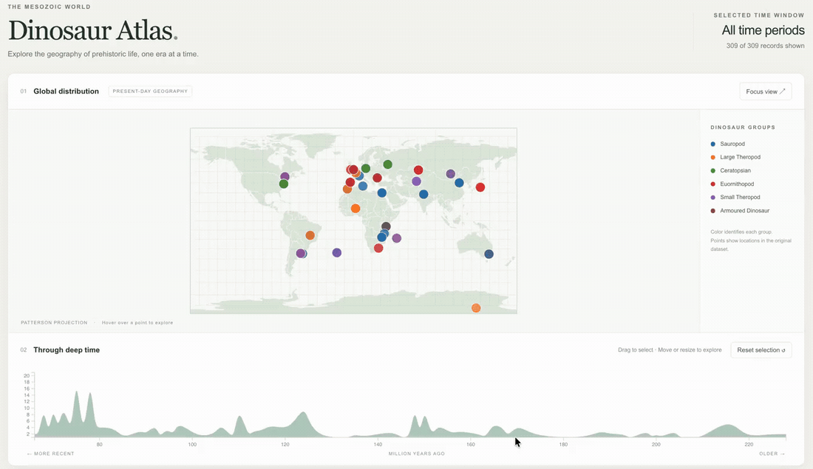

# Interactive Map of Dinosaur Records

An interactive visualization for exploring where dinosaur records are located and when the represented species lived. A world map and geological timeline work together: selecting a time interval updates the records shown on the map.

The project connects geographic coordinates with temporal filtering, allowing viewers to explore the same records through both location and geological age.

**Technologies:** JavaScript, D3.js, GeoJSON, HTML, CSS

## Preview



The preview runs at twice the recording's original speed. The [full recording](assets/dinosaur-demo.mp4) retains its original playback speed.

## Exploring the map

- Drag across the timeline to select a geological time interval
- Move or resize the selection to compare different periods
- View the corresponding records at their geographic coordinates
- Use the color legend to distinguish the categories shown on the map
- Follow animated updates as the selected time interval changes

The dataset contains 309 records and spans multiple geological periods. Although the original dataset uses the name “Jurassic Park,” the visualization extends beyond the Jurassic period.

## How it works

The visualization loads a GeoJSON world map and a cleaned CSV of dinosaur records. D3's Patterson projection converts longitude and latitude into screen positions. A horizontal brush on the timeline controls the time selection, which updates the map's data points and transitions.

The linked views make it possible to compare the geographic distribution of the available records across time without switching between separate charts.

## Running locally

Keep `index.html`, `style.css`, `js/`, `world.geojson`, and `jurassic_park_clean.csv` together in the project directory. From that directory, run:

```bash
python3 -m http.server 8000
```

Then open <http://localhost:8000> in a browser. A local server allows the visualization to load its CSV and GeoJSON files. The original page also loads JavaScript and CSS dependencies from external CDNs, so it requires an internet connection.

## Main files

| File | Purpose |
| --- | --- |
| `index.html` | Page structure and dependency imports |
| `style.css` | Page and visualization styling |
| `js/main.js` | Geographic projection, timeline, brush interaction, and map updates |
| `jurassic_park_clean.csv` | Cleaned records used by the visualization |
| `world.geojson` | Geographic boundaries for the base map |

## Reading the visualization

The map uses present-day geographic coordinates. It does not reconstruct the positions of continents in the geological past. The plotted records describe the available dataset, rather than a complete census of dinosaur populations or their historical ranges.

## Related work

[Project background and other work](https://sidharth-dinesh.github.io/) · [GitHub profile](https://github.com/Sidharth-Dinesh)
